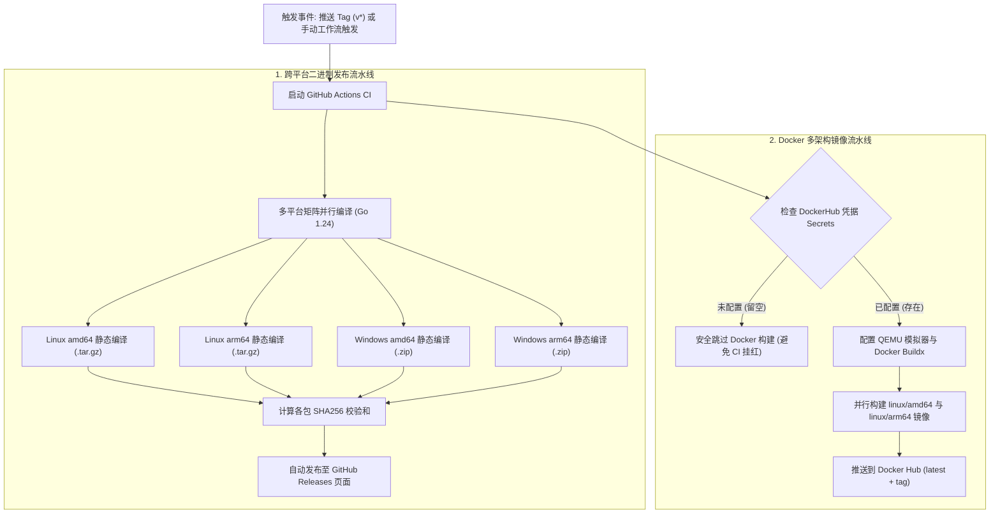
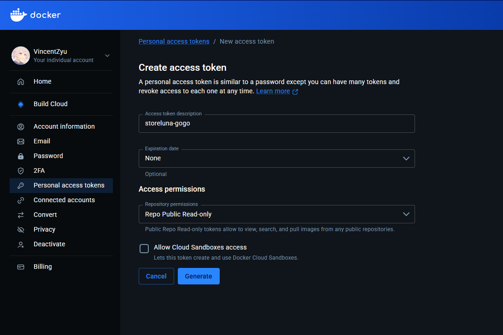

# storeluna-gogo CI/CD 与自动化发布指南

本文档介绍 `storeluna-gogo` 的 GitHub Actions 持续集成与发布机制，以及如何使用 GitHub CLI (`gh`) 快速配置 Docker Hub 密钥。

---

## 1. 工作流功能矩阵

工作流定义在 `.github/workflows/ci.yml`，具备以下能力：

1. **跨平台二进制静态构建 (`build-binaries`)**：
   - 支持平台矩阵：
     - `linux/amd64` (tar.gz)
     - `linux/arm64` (tar.gz)
     - `windows/amd64` (zip)
     - `windows/arm64` (zip)
   - 自动生成对应平台的 SHA256 校验和文件。
2. **GitHub Releases 自动发布 (`publish-release`)**：
   - 推送 `v*` 格式的 Git Tag 时自动触发，将各平台的二进制压缩包与校验码发布到 Releases 页面。
3. **多架构 Docker 镜像构建与推送 (`docker-build`)**：
   - 基于 Docker Buildx 构建 `linux/amd64` 与 `linux/arm64` 双架构镜像。
   - 自动标记为 `latest` 以及对应的版本 Tag。
   - **自适应防报错机制**：如果仓库未配置 DockerHub 密钥，将安全跳过推送步骤，不影响二进制的 Release 发布。

### CI/CD 执行架构流程图



---

## 2. 如何获取 Docker Hub Token

若需要自动推送镜像至 Docker Hub，需准备个人访问令牌（PAT）：

1. 登录 [Docker Hub 控制台](https://hub.docker.com/)。
2. 点击右上角个人头像 ➔ **Account Settings** ➔ 左侧菜单选择 **Security**。
3. 在 **Personal access tokens** 区域点击 **New Access Token**。
4. 填写说明（如 `github-actions-storeluna`），权限选择 **Repo Read, Write, Delete**。
   > 💡 **为什么必须选择 Repo Read, Write, Delete？**
   > CI 流水线不仅负责构建并推送镜像层，还会在构建完成后自动调用 Docker Hub OpenAPI 将最新的 `README.md` 与项目介绍同步到 Docker Hub 仓库主页。Docker Hub 严格限制只有具备 `Delete` 级别（即完整仓库管理权限）的 Token 才能调用该修改接口，否则会返回 `403 Forbidden`。
5. **关于 Allow Cloud Sandboxes access 勾选框**：
   - **不需要勾选（保持默认留空）**。
   - *说明*：该选项用于授权创建和使用 Docker 官方的云端沙盒环境（Cloud Sandboxes）；GitHub Actions 构建推送镜像仅需标准的仓库读写权限，保持不勾选遵循最小权限原则，更安全。
6. 点击 **Generate**，**立即复制生成的 Token 字符串**（仅显示一次）。



---

## 3. 使用 GitHub CLI (`gh`) 配置仓库 Secret

在本地终端（已安装并登录 `gh auth login`），可以直接一条命令为当前仓库配置密钥：

### 3.1 设置 Docker Hub 用户名
```bash
gh secret set DOCKERHUB_USERNAME --body "vincentzyu233"
```

### 3.2 设置 Docker Hub Token
```bash
# 交互式输入，避免 Token 明文记录到终端历史
gh secret set DOCKERHUB_TOKEN
# 提示输入时粘贴刚才从 Docker Hub 复制的 Token 即可
```

### 3.3 查看已配置的 Secrets 列表
```bash
gh secret list
```
输出中若包含 `DOCKERHUB_USERNAME` 和 `DOCKERHUB_TOKEN` 即表示配置成功。

---

## 4. 触发发布与构建

### 方式 A：通过推送 Git Tag 触发（标准发布）
```bash
# 打上新版本标签
git tag v1.0.0
# 推送标签触发构建
git push origin v1.0.0
```

### 方式 B：通过 GitHub CLI 手动触发
```bash
# 手动触发 Actions 并传入版本号
gh workflow run ci.yml -f tag_name="v1.0.0"
```
可在 GitHub 仓库的 **Actions** 面板查看实时编译与上传进度。
